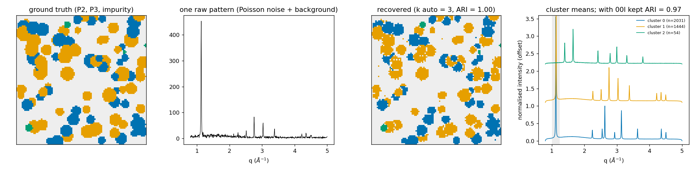
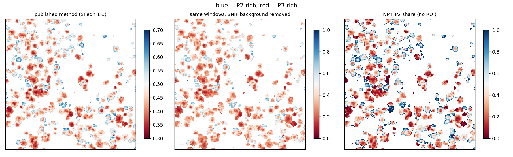
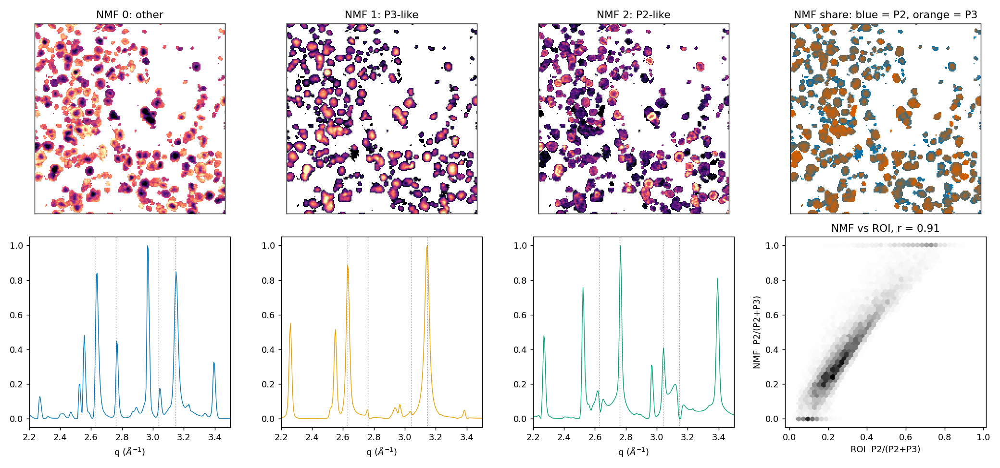
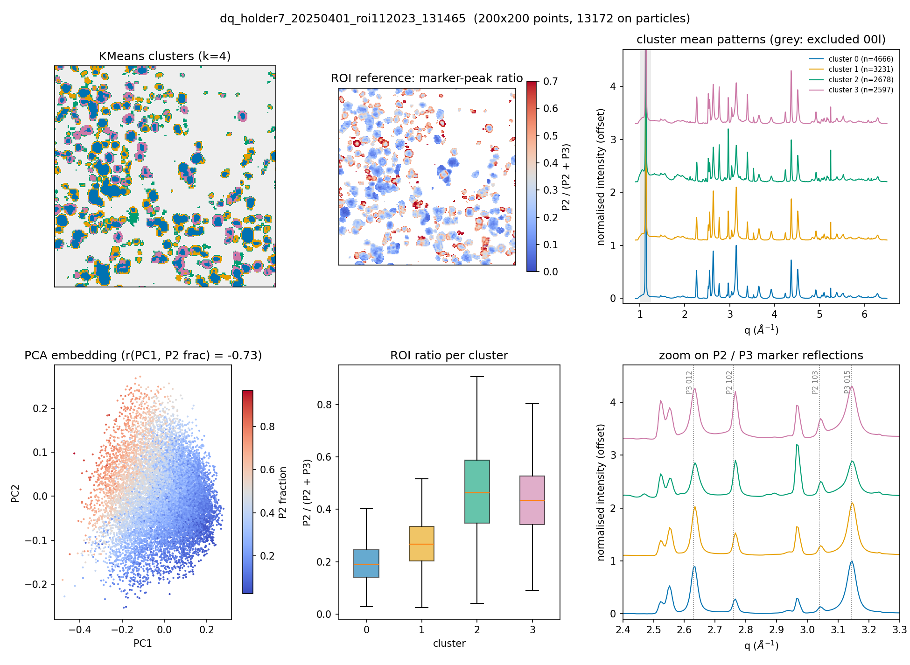

# uxrd-phasemap-id13: unsupervised phase mapping for scanning micro-XRD

[](https://github.com/<your-username>/uxrd-phasemap-id13/actions)

In a synchrotron scanning micro-diffraction experiment you record one 1D pattern
`I(q)` at every beam position, which quickly adds up to tens of thousands of patterns
per map. The classical analysis integrates a few hand-picked reflections (region-of-interest
maps). That works when you already know which phases to look for, but it ignores
most of the pattern and misses anything unexpected.

`uxrd-phasemap-id13` (import name `uxrd_phasemap_id13`) is a small, tested Python package that works on **every pattern in the map
without supervision**:

```
raw I(q) map ─► q-crop ─► SNIP background ─► noise-aware particle mask
            ─► features: sqrt (variance-stabilising) + L2 normalisation
               (texture-dominated reflections can be excluded)
            ─► PCA ─► KMeans / Gaussian mixture (k chosen by silhouette / BIC)
            └► NMF on peak patterns ─► non-negative "phase" patterns + abundance maps
```

It reads the HDF5 files written by the ESRF **ewoks / pyFAI** integration pipeline
(e.g. ID13) directly, and generic arrays through `XRDMap`.

## Results

### 1. Synthetic benchmark (known ground truth)

Two layered-oxide polytypes (P2, P3) and a minor impurity. The peak positions are
calculated from their hexagonal cells. The simulation adds a sloping amorphous
background, Poisson noise, particle-thickness variation and a randomly re-weighted
00l reflection to mimic crystallite orientation.



| features | k chosen by silhouette | adjusted Rand index |
|---|---|---|
| all q | 2 (impurity merged away) | 0.97 |
| 00l window excluded | **3** | **1.00** |

When the orientation-dependent basal reflection dominates the feature vector, the
small impurity population is lost. Removing that window recovers all three phases.
`python examples/synthetic_demo.py` reproduces this.

### 2. Real data: biphasic P2/P3 Na-layered oxide, ESRF ID13

The sample and the published ROI analysis come from
[Xu *et al.*, *ACS Energy Lett.* **2025**, 10, 6347](https://doi.org/10.1021/acsenergylett.5c03108)
(Fig. 1c and SI). The material is Li-substituted Na<sub>x</sub>(Li,Ni,Mn)O<sub>2</sub>
calcined at 700 °C, which gives a mixture of the P2 and P3 polytypes. The powder was
spread sparsely between Kapton tapes. The scan uses 2 µm × 2 µm pixels over a
400 µm × 400 µm region, which gives 40 000 patterns per map (Eiger 4M, λ = 0.954 Å,
pyFAI/ewoks integration, 1400 q bins). The paper maps the ratio
102<sub>P2</sub> / (102<sub>P2</sub> + 012<sub>P3</sub>) and finds a
**P2 shell nucleating on P3-rich cores**.

**Three independent routes give the same core–shell picture** (map 1):



1. *Published method.* The beamline ROI maps turned out to be plain sums of the
   integrated intensity over q = 2.737–2.790 Å⁻¹ (102<sub>P2</sub>) and
   2.591–2.679 Å⁻¹ (012<sub>P3</sub>); `window_sum` reproduces the `.dat` files
   exactly. Each map is then normalised to its maximum, a 15 % threshold is applied,
   and the ratio a/(a+b) is taken (`normalized_ratio`).
2. *Same windows after SNIP background removal.* Inside particles, the diffuse
   background makes up about 50–60 % of the counts in these windows. It adds a similar
   offset to both channels and pulls the ratio towards 0.5, which explains the
   narrow 0.3–0.7 colour range of the published figure. Removing it widens the
   dynamic range (median 0.46 → 0.35). The spatial pattern stays the same
   (pixel-wise r = 0.99), so the published conclusion is unaffected.
3. *No ROI at all.* A 3-component NMF on the full background-free patterns finds a
   P3-like component (012, 015, 107, 018), a P2-like component (100, 102, 103, 104)
   and a third component for the remainder. The P2 share from NMF agrees with a
   background-corrected multi-reflection ROI ratio at **r = 0.91 (map 1) and 0.89
   (map 2)**.



**KMeans clusters** (k = 4, 00l excluded) separate P3-rich cores from P2-richer
rims. The median background-corrected P2 ratio is 0.19 and 0.27 in the two core
clusters and 0.43–0.46 in the two rim clusters. PC1 alone correlates with the ROI
ratio at |r| = 0.73.



**What the model-selection score says.** The silhouette score peaks at k = 2 (0.34)
and then stays flat (0.21–0.23 for k = 3–6). A gradual P3 → P2 conversion should
produce exactly this: a *continuum* of P2/P3 mixtures, not a few discrete phases. Hard
clustering is therefore a coarse description, and the additive NMF model matches the
physics better.

On the second map, a 24-pixel cluster has a pattern with none of the P2/P3
reflections (strongest peaks at q ≈ 2.40 and 2.97 Å⁻¹). The ROI analysis cannot see
this phase because no ROI was ever defined for it. It is still unassigned; residual
Na salts are candidates, since Rietveld refinement of the bulk powders shows
2–4 wt % Na₂CO₃.

### Limitations / honest notes

* Intensities are affected by crystallite orientation (spotty rings in micro-XRD). The
  ROI ratio and the NMF share are **intensity** ratios, not weight fractions.
* The 2 µm beam is larger than many primary particles, and particle edges have lower
  signal-to-noise. Part of a rim contrast can therefore come from partial-volume
  effects, so rim assignments should be checked against the raw 2D frames.
* After background removal, a phase-pure pixel has ≈ 0 intensity in the other
  window. The per-channel 15 % cut of the published recipe would then drop pure
  cores, so on corrected data the pixels are masked by total signal instead.
  With raw ROI sums the background floor (≈ 9 % of the maximum in each channel)
  largely avoids this: 7–9 % of the pixels above threshold fail only one channel,
  and these are mostly weak edge pixels.
* SNIP needs a window wider than the Bragg peaks but narrower than the amorphous
  background (`snip_iterations`). The default (40 bins ≈ 0.2 Å⁻¹ here) was checked visually.

## Install & use

```bash
pip install -e ".[dev]"
pytest                     # 15 tests, synthetic data only, ~5 s
```

Command line:

```bash
uxrd-phasemap-id13 dq_scan.h5 --qrange 0.9:6.5 --exclude 1.0:1.25 -k 2 3 4 5 6 --nmf 3 --out results/
```

Python:

```python
from uxrd_phasemap_id13 import load_ewoks_h5, PhaseMapper, phase_fraction

xmap = load_ewoks_h5("dq_scan.h5")                     # shape inferred for square maps
res = PhaseMapper(q_range=(0.9, 6.5), exclude_q=[(1.0, 1.25)],
                  n_clusters=[2, 3, 4, 5], n_nmf=3).fit(xmap)
print(res.summary())
res.label_image()        # (rows, cols) cluster map, -1 = no particle
res.mean_patterns()      # average background-free pattern per cluster
res.nmf_patterns         # non-negative component patterns
```

The full real-data analysis, including the ROI cross-check, is in
[`examples/id13_layered_oxide.py`](examples/id13_layered_oxide.py). A walk-through
on synthetic data is in [`examples/quickstart.ipynb`](examples/quickstart.ipynb).

## Layout

```
src/uxrd_phasemap_id13/
  io.py          ewoks/pyFAI HDF5 reader, XRDMap container
  preprocess.py  vectorised SNIP baseline, Otsu + Poisson-noise particle mask, features
  cluster.py     PhaseMapper pipeline (PCA, KMeans/GMM, k selection, NMF)
  roi.py         ROI sums/areas, marker-peak ratio, published two-reflection ratio
  synthetic.py   physically-motivated synthetic maps with ground truth
  plotting.py    colour-blind-safe figures
  cli.py         command line entry point
tests/           unit + end-to-end tests (CI via GitHub Actions)
```

Beamline data are not included (`*.h5` is git-ignored).

## Author

Mingfeng Xu, University of Bayreuth. The data were measured at ESRF ID13
(proposal in1187) for Xu, Thapliyal, Laurier, Tucoulou, Burghammer, Seidlmayer,
Bianchini, *ACS Energy Lett.* 2025, 10, 6347. MIT licence.
